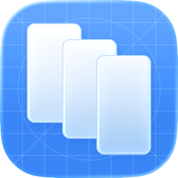
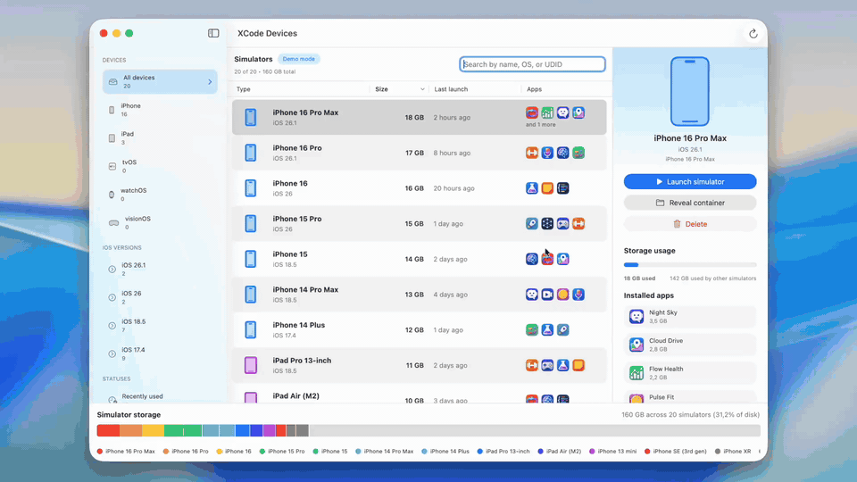
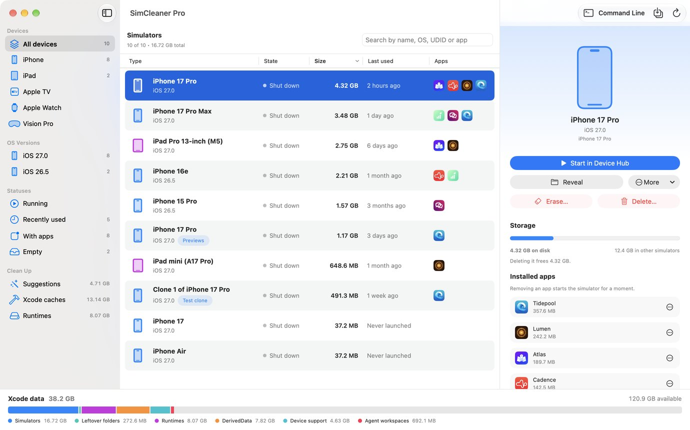
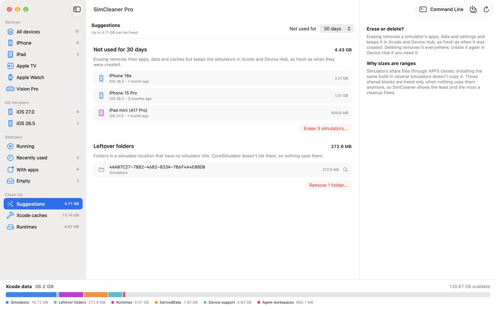
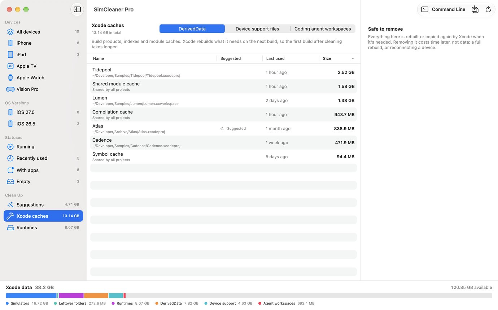

<p align="center">
  
</p>

<h1 align="center">SimCleaner for Xcode</h1>

<p align="center">
  A Mac app that shows every Xcode simulator on your disk, how much space each one takes, and cleans up the simulators and Xcode caches you don't need.
</p>

<p align="center">
  <a href="https://apps.apple.com/us/app/simcleaner-for-xcode/id6755651521">Mac App Store</a> ·
  <a href="#two-editions">SimCleaner Pro</a> ·
  <a href="#build-from-source">Build from source</a> ·
  <a href="LICENSE">MIT License</a>
</p>



Simulators pile up. Every Xcode release adds a new batch, test runs clone devices, SwiftUI Previews make their own, and after a year it's common to find 50–100 GB sitting in `~/Library/Developer`. DerivedData and device support files add more on top. Xcode has no single screen that shows all of it. SimCleaner does.

## What it does

- Every simulator (iPhone, iPad, Apple Watch, Apple TV, Vision Pro) is in one table you can search by name, model, iOS version, UDID or the name of an installed app.
- A bar at the bottom of every page shows what simulators, runtimes, DerivedData, device support files, agent workspaces and simulator caches take, next to the space you have left. Click a colour to open the page that cleans it.
- Each simulator shows its size, so the big ones stand out. Because simulators share files through APFS clones, deleting one can free less than its size; when that matters, you see the least and the most a cleanup frees.
- Cleanups add up in a "Freed about" total next to the bar: an estimate that counts only what is gone from disk, each item by the bytes it held alone where APFS can tell. It starts again an hour after your last cleanup.
- You see when you last used each simulator. Devices Xcode created but never booted say "Never launched".
- The apps inside each simulator are listed with how much space each app and its data take, and you can open an app's Documents, Caches or Preferences folder in Finder.
- Suggestions point out simulators you haven't used for a few weeks, ones that can't run because their runtime is gone, and folders no simulator owns.
- Xcode caches get their own page: DerivedData, device support files, and the build folders coding agents leave behind through XcodeBuildMCP or MobileBuildMCP.
- Deleting, erasing, shutting down, duplicating and renaming go through Xcode's own `simctl`, so Xcode and Device Hub see the change right away. SimCleaner asks before anything destructive.
- One build can go onto several simulators at once.
- Any simulator opens in Device Hub (Xcode 27) or Simulator, and you can reveal its folder in Finder.

| Simulators | Suggestions | Xcode caches |
| --- | --- | --- |
|  |  |  |

<sub>Screenshots use sample projects.</sub>

## Two editions

SimCleaner comes in two editions. Both are free, both are built from this repository, and they share the same code and the same window. The difference is the App Sandbox.

Every app in the Mac App Store runs in the sandbox. Inside it, macOS keeps the app away from the CoreSimulator service that mounts simulator runtimes, so a sandboxed app can't start a simulator or delete a runtime, and Apple no longer approves the exception that would allow it. Those features live in **SimCleaner Pro**, a separate download that runs outside the sandbox and is notarized by Apple.

| | App Store | Pro |
| --- | --- | --- |
| Price | Free | Free |
| Requires | macOS 15.6 or later | macOS 27 and Xcode 27 |
| Install and updates | Mac App Store | DMG from [Releases](https://github.com/Stepanokdev/SimCleaner/releases) |
| Simulators, sizes, apps, last use | ✓ | ✓ |
| Delete, erase, shut down, duplicate, rename | ✓ | ✓ |
| Cleanup suggestions | ✓ | ✓ |
| DerivedData, device support files, agent workspaces | ✓ | ✓, and marks DerivedData whose project is gone |
| Start a simulator | Opens it in Device Hub or Simulator | Starts it, then opens it |
| Remove an app from a simulator | Running simulators | Starts the simulator for a moment |
| Install one build on several simulators | Running simulators | Starts each one, installs, shuts it down |
| Delete runtimes | Shows them and where to delete them | ✓ |
| `simcleaner` command line tool | | ✓ |
| Tip jar | ✓ | |

If you clean up simulators by hand now and then, the App Store edition is enough, and it updates itself. Pro is for runtimes, for starting simulators without leaving the app, for installing one build on many of them, and for scripts and coding agents.

The App Store edition mentions Pro only next to a feature it can't do, with a link back here. Until the first Pro release is on the Releases page, build it from source with the **SimCleaner Pro** scheme.

## Command line

SimCleaner Pro includes `simcleaner`, a command line tool with the same rules as the app. To put it on your `PATH`:

```sh
sudo ln -sf "/Applications/SimCleaner Pro.app/Contents/MacOS/simcleaner" /usr/local/bin/simcleaner
```

```sh
simcleaner                          # where the space goes: simulators, runtimes, caches
simcleaner suggest                  # what's worth cleaning, and the command that does it
simcleaner list --running --json
simcleaner caches list
simcleaner caches remove --suggested --yes
simcleaner runtimes list
simcleaner erase 35D56CF8-69AC-4DD7-BD86-98F388A27A9B --yes
simcleaner install MyApp.app --to "iPhone 18 Pro" "iPad Air 13-inch (M3)"
```

Commands that delete something (`erase`, `delete`, `caches remove`, `runtimes delete`) print what they would do and exit with code 2 until you add `--yes`. `install` exits with 1 unless every simulator you named got the app and was left running or shut down the way it was found; its JSON says what happened to each one. Simulators are named by UDID or by exact name; a name that matches more than one simulator is refused. Listings take `--json`, and the JSON keys stay stable, so scripts and coding agents can rely on them. What SimCleaner couldn't read is never reported as zero: `storage` prints "couldn't read", and its JSON marks the line `"coverage": "unreadable"` and leaves out the sizes; a line marked `"partial"` may be missing some folders. `runtimes list` exits with 1 when it can't read the runtimes.

## Where it looks

Xcode keeps simulators in four places, all inside `~/Library/Developer`:

| Folder | What's in it | Label in SimCleaner |
| --- | --- | --- |
| `CoreSimulator/Devices` | Simulators you create in Xcode or with `simctl` | — |
| `Xcode/UserData/Previews/Simulator Devices` | Devices created for SwiftUI Previews | Previews |
| `XCTestDevices` | Clones made for parallel test runs | Test clone |
| `XCPGDevices` | Devices used by Swift Playgrounds | Playground |

Xcode caches come from `Xcode/DerivedData`, the `Xcode/… DeviceSupport` folders, and `XcodeBuildMCP/workspaces` and `MobileBuildMCP/workspaces`.

The App Store edition asks for access the first time it runs. Choose `~/Library/Developer`: one grant covers all of these folders. If you pick a folder above or below it (your home folder, `CoreSimulator`, `Devices`), SimCleaner still finds the simulators inside, but Xcode caches need the `Developer` folder itself. Pro reads `~/Library/Developer` directly and doesn't ask.

## Simulator runtimes

A simulator is a folder of device data: apps, settings, caches. The iOS system it runs on is a separate download called a **runtime**. A runtime takes several gigabytes, and all simulators of that iOS version share it, so deleting simulators doesn't free that space.

SimCleaner Pro lists runtimes with their size, when a simulator last used each one and how many simulators depend on it, and deletes the ones you choose through CoreSimulator. The App Store edition lists them with their size and how many simulators use them, but not when they were last used, and can't delete them. Use **Xcode → Settings → Components** for that, or `xcrun simctl runtime delete RUNTIME_ID` in Terminal with an ID from `xcrun simctl runtime list`.

## macOS 27 and Xcode 27

Version 1.2 fixes what broke with the 2026 releases:

- Xcode 27 renamed the "last used" date that CoreSimulator writes (`lastBootedAt` became `lastUsedAt`). Older versions of SimCleaner showed "Never launched" for every simulator. Both keys are read now.
- Simulators are found in all four folders listed above, not only the one you picked.
- The folder picker opens at your real `~/Library/Developer`. Inside the App Sandbox the default location used to point at the app's own container.
- When a folder has no simulators, the app now tells you why (wrong folder, unreadable folder, or runtimes) instead of just showing "0 found".

## Privacy

Neither edition collects analytics or talks to a server of its own. The App Store edition runs in the App Sandbox without network access; its optional tip jar goes through Apple's StoreKit. Pro runs outside the sandbox so it can start simulators and delete runtimes, and it makes no network requests either. Both delete only what you select: simulators and runtimes through Xcode's `simctl`, cache folders only inside `~/Library/Developer`. If `simctl` can't be used (Xcode missing, the license not accepted, a timeout), SimCleaner doesn't delete simulators at all while CoreSimulator is on the Mac, because something may still be using them.

## Build from source

Requirements: Xcode 27. The App Store edition runs on macOS 15.6 or later, Pro on macOS 27.

```sh
git clone https://github.com/Stepanokdev/SimCleaner.git
cd SimCleaner
open SimCleaner.xcodeproj
```

Choose the **XCode Devices** scheme for the App Store edition or **SimCleaner Pro** for Pro, set your own team under *Signing & Capabilities*, and run. The Pro scheme also builds `simcleaner` and copies it into the app; the **SimCleaner** scheme builds all three and runs the app tests. Without a signing certificate you can still build and test with ad-hoc signing:

```sh
xcodebuild -project SimCleaner.xcodeproj -scheme "XCode Devices" -destination 'platform=macOS' \
  CODE_SIGN_IDENTITY=- CODE_SIGN_STYLE=Manual DEVELOPMENT_TEAM= PROVISIONING_PROFILE_SPECIFIER= test

swift test --package-path Packages/SimCleanerKit
```

The tests build throwaway `~/Library/Developer`-shaped folders on disk and talk to a fake `simctl`, so they never touch your real simulators. Two integration tests use the real one: the package test creates, clones, erases and deletes a simulator in a throwaway device set, and the app test checks what `simctl` can do from inside the sandbox. They run only with `SIMCLEANER_INTEGRATION=1` (`TEST_RUNNER_SIMCLEANER_INTEGRATION=1` for `xcodebuild test`).

### Project layout

| Folder | What it does |
| --- | --- |
| `Packages/SimCleanerKit` | Everything that isn't UI: finding simulators, APFS-aware sizes, `simctl`, cleanup rules, Xcode caches, runtimes, installs. Both editions and the CLI use it. |
| `XCode Devices/` | The window both editions share: sidebar, simulator table, details, cleanup pages, install sheet |
| `Editions/AppStore/` | What only the App Store edition has: sandbox entitlements, tip jar, rating prompt |
| `Editions/Pro/` | What only Pro has: its entitlements and the command line tool sheet |
| `CLI/` | The `simcleaner` command line tool |
| `XCode DevicesTests/` | Tests for the app's view model and page layout |

Each edition folder defines the same few symbols (`AppEdition.current`, `EditionToolbarButton`, `EditionHooks`), so the shared code has no `#if`. Features that depend on the sandbox check `Capabilities` at runtime instead.

## Contributing

Bug reports and pull requests are welcome. If simulators are missing or dates look wrong, please mention your macOS and Xcode versions. The output of `xcrun simctl list devices -j` helps a lot.

## License

MIT, for both editions. See [LICENSE](LICENSE).
