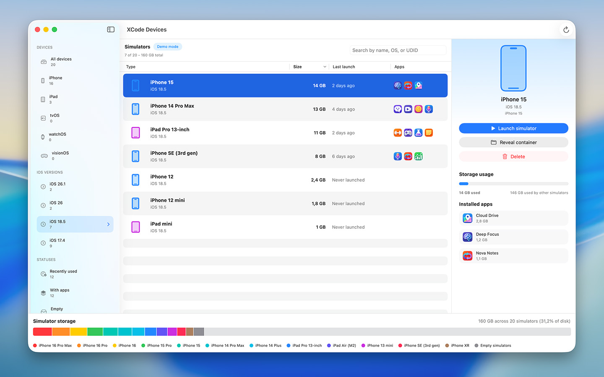
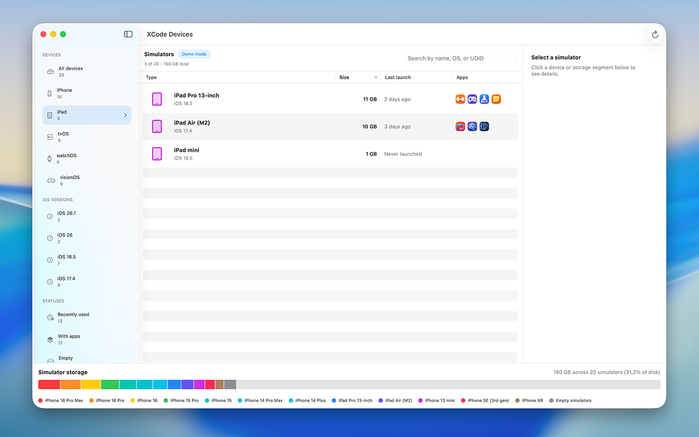

<p align="center">
  
</p>

<h1 align="center">SimCleaner for Xcode</h1>

<p align="center">
  A Mac app that shows every Xcode simulator on your disk, how much space each one takes, and lets you delete the ones you don't use.
</p>

<p align="center">
  <a href="https://apps.apple.com/us/app/simcleaner-for-xcode/id6755651521">Mac App Store</a> ·
  <a href="#build-from-source">Build from source</a> ·
  <a href="LICENSE">MIT License</a>
</p>


Simulators pile up. Every Xcode release adds a new batch, test runs clone devices, SwiftUI Previews make their own, and after a year it's common to find 50–100 GB sitting in `~/Library/Developer`. Xcode has no single screen that shows all of it. SimCleaner does.

## What it does

- **Lists every simulator** (iPhone, iPad, Apple Watch, Apple TV, Vision Pro) in one searchable table. Search works by name, model, iOS version or UDID.
- **Shows the size** of each simulator and a storage bar for all of them together, so the biggest ones are obvious.
- **Shows when you last used each one.** Devices Xcode created but never booted are marked "Never launched".
- **Shows installed apps** inside each simulator, with how much space each app and its data take.
- **Launches a simulator** with one click, or reveals its folder in Finder.
- **Deletes simulators** one at a time or in bulk. It asks first, warns you if a simulator is still running, and only touches the folders you gave it access to.

| All simulators | Filtered by iOS version | Filtered by device type |
| --- | --- | --- |
|  |  |  |

<sub>Screenshots use the app's demo data.</sub>

## Where it looks

Xcode keeps simulators in four places, all inside `~/Library/Developer`:

| Folder | What's in it | Label in SimCleaner |
| --- | --- | --- |
| `CoreSimulator/Devices` | Simulators you create in Xcode or with `simctl` | — |
| `Xcode/UserData/Previews/Simulator Devices` | Devices created for SwiftUI Previews | Previews |
| `XCTestDevices` | Clones made for parallel test runs | Test clone |
| `XCPGDevices` | Devices used by Swift Playgrounds | Playground |

When the app asks for access, choose `~/Library/Developer`. One grant covers all four folders. If you pick a folder above or below it (your home folder, `CoreSimulator`, `Devices`), SimCleaner still finds what's inside.

## What it doesn't delete: simulator runtimes

A simulator is a folder of device data: apps, settings, caches. The iOS system it runs on is a separate download called a **runtime**. A runtime takes several gigabytes, and all simulators of that iOS version share it.

macOS stores runtimes in `/System/Library/AssetsV2` and protects that folder. SimCleaner shows how much space they take, but it can't delete them, and deleting simulators won't free that space. To remove a runtime, open **Xcode → Settings → Components** and delete the ones you no longer need.

## macOS 27 and Xcode 27

Version 1.2 fixes what broke with the 2026 releases:

- Xcode 27 renamed the "last used" date that CoreSimulator writes (`lastBootedAt` became `lastUsedAt`). Older versions of SimCleaner showed "Never launched" for every simulator. Both keys are read now.
- Simulators are found in all four folders listed above, not only the one you picked.
- The folder picker opens at your real `~/Library/Developer`. Inside the App Sandbox the default location used to point at the app's own container.
- When a folder has no simulators, the app now tells you why (wrong folder, unreadable folder, or runtimes) instead of just showing "0 found".

## Privacy

SimCleaner runs in the App Sandbox with no network access. It reads and deletes files only inside the folder you choose, and it doesn't collect analytics. The optional tip jar uses Apple's StoreKit.

## Build from source

Requirements: Xcode 26 or later (tested with Xcode 27). The app runs on macOS 15.6 or later.

```sh
git clone https://github.com/Stepanokdev/SimCleaner.git
cd SimCleaner
open SimCleaner.xcodeproj
```

Choose the **XCode Devices** scheme, set your own team under *Signing & Capabilities*, and run. Without a signing certificate you can still build and test with ad-hoc signing:

```sh
xcodebuild -project SimCleaner.xcodeproj -scheme "XCode Devices" -destination 'platform=macOS' \
  CODE_SIGN_IDENTITY=- CODE_SIGN_STYLE=Manual DEVELOPMENT_TEAM= PROVISIONING_PROFILE_SPECIFIER= test
```

The tests build throwaway `~/Library/Developer`-shaped folders on disk and check device discovery, date handling and deletion rules. Nothing touches your real simulators.

### Project layout

| File | What it does |
| --- | --- |
| `XCode Devices/Item.swift` | Finds device sets, reads each `device.plist`, measures sizes, deletes device folders |
| `XCode Devices/ContentView.swift` | Main window: sidebar filters, simulator table, details panel, storage bar |
| `XCode Devices/RuntimeStorageSheet.swift` | The "Simulator runtimes" explanation |
| `XCode DevicesTests/` | Fixture-based tests for the scanner and deletion |

## Contributing

Bug reports and pull requests are welcome. If simulators are missing or dates look wrong, please mention your macOS and Xcode versions. The output of `xcrun simctl list devices -j` helps a lot.

## License

MIT. See [LICENSE](LICENSE).
